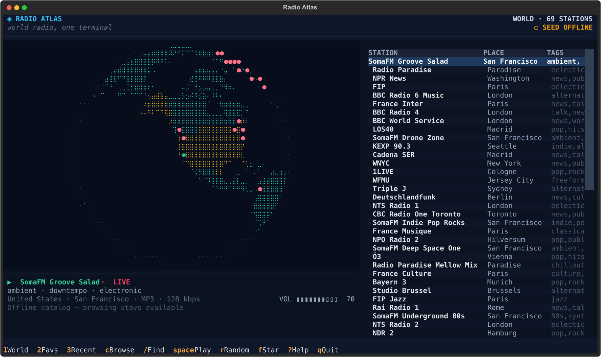

# Radio Atlas TUI

**World radio, one terminal.**

```text
                           ⠂⣀⣀⣠⢤⡤⠤⠤⣄⣀⣀⠂
                       ⠂⣀⣤⣶⣿⣿⠿⠿⠄  ⠠⠌⠉⠁●●●●⠂
                     ⠂⣴⣾⠿⣿⣿⣿      ⣠⢾⣿⣶⣦⡑ ●●●⡀
                   ⠂⡐⠘⠉⢁⣄⢽⣿⣷⠐⢀   ⡠⣘⡵⡤⢄⡈⠛⠂   ●●⠂
                  ⠂⠂⠁      ⢘⣴⣿⣿⣶⣶⣾⣽⣽⡿⠠⢩⣤⣤⣤⣀   ⠂⠂
                 ⠂⠂        ⠐⠉⠉⠙⢿⣿⣿⣿⣿⣷⣤⣤⣸⣿⣯⣨    ⠂⠂
                ⠂⠂⠂            ⠈●⣿⣿⣿⣿⣿⣿⣿●●●    ⠂⠂⠂
                ⠂⠂              ⢸●⣿⣿⣿⣿⣿⣿⣿●⠄     ⠂⠂
                ⠂⠂              ⠈◉⣿⣿⣿⣿⣿⣿⡿⠿⡀     ⠂⠂
                ⠂⠂                ⠹⡻⣿⣿⣿⠁  ⠄⠒⠐ ⢠⢀⠠⠂
                ⠂⠂⠂                ⠈⠊⠻⣿⣦⣤⣇⣤ ⢠⣶⣿⣿⡇⠂
                 ⠂⠂                       ⠈ ●⣿⣿⡟⠂
                  ⠂⠂                       ⢸⣿⣿⡟⠂
                   ⠂⠂⠂                      ⢩⠏⠂
                     ⠂⠂⠂                  ⠂⠔⠁
                       ⠂⠂⠂⠂⠂          ⠂⠂⠂⠂⠂
                           ⠂⠂⠂⠂⠂⠂⠂⠂⠂⠂⠂⠂
```

Radio Atlas is a keyboard-driven terminal application for discovering and
playing live radio from around the world. A braille globe is the navigation
surface: rotate it, tilt it, zoom in, click a country, and drill from country
to city to station without ever leaving the terminal.

Built with [Textual](https://textual.textualize.io/), the
[Radio Browser](https://www.radio-browser.info/) directory, and
[mpv](https://mpv.io/) for playback. No account, no telemetry, no browser tab.



---

## The idea

Radio directories are lists. Lists are efficient, but they hide the one thing
that makes world radio interesting: **where the signal comes from**.

Radio Atlas puts geography first. The globe is not decoration; it is the
primary index. Every station you can play has a coordinate, and every country
you can open is a shape on the map. Search and lists exist for when you already
know what you want. The map exists for when you do not.

```text
┌ ◉ RADIO ATLAS ────────────────────────────────── WORLD · 69 STATIONS ┐
│ world radio, one terminal                          ○ SEED OFFLINE │
├──────────────────────────────────────┬───────────────────────────────┤
│                                      │ / Search stations…            │
│                                      │ ──────────────────────────    │
│            braille globe             │ STATION           PLACE       │
│         rotate · tilt · zoom         │ ▸ SomaFM Groove…  San Fran…   │
│                                      │   Radio Paradise  Paradise    │
│           ●      ◉      ●            │   NPR News        Washington  │
│                  ●                   │   FIP             Paris       │
│                                      │   BBC 6 Music     London      │
├──────────────────────────────────────┤  France Inter    Paris        │
│ ▶ SomaFM Groove Salad · LIVE         │   BBC Radio 4     London      │
│ ambient · downtempo · electronic     │   KEXP 90.3       Seattle     │
│ US · San Francisco · MP3 · 128k      │   Triple J        Sydney      │
│ VOL ▮▮▮▮▮▮▮▯▯▯ 70                    │                               │
├──────────────────────────────────────┴───────────────────────────────┤
│ 1 World  2 Favs  3 Recent  c Browse  / Find  space Play  ? Help      │
└──────────────────────────────────────────────────────────────────────┘
```

The left column is the map, then the now-playing panel. The right column is
search, then whichever list the current mode needs. One list is visible at a
time; each keeps its own cursor, and `esc` walks back up the hierarchy.

---

## The globe

The map is real geography, not an illustration. `scripts/build_geo_assets.py`
converts Natural Earth 1:110m country polygons into two compact assets:

- `countries.json` — 177 countries with ISO code, name, continent, and label
  coordinates;
- `worldmask.bin` — a 1440 × 720 byte mask where `0` is ocean and `1..255` is
  a country index.

The full GeoJSON is never shipped. At render time each terminal cell becomes a
2 × 4 braille grid, and every visible dot samples the mask through an inverse
orthographic projection:

```text
 one terminal cell  =  2 × 4 dots  =  8 braille bits

     ⠁  ⠂  ⠄  ⡀          dot 1 … dot 8 → bits 0 … 7 of U+2800
     ⠈  ⠐  ⠠  ⢀          a full cell is ⣿

     ⢀⣀⣀⣤⣤⣤⣤⣀⣀⡀        each dot asks worldmask.bin:
     ⣠⣴⣶⣿⣿⡿⠏⠉⠂⠁        "is this ocean, land, or the focused country?"
```

The same mask answers hit-testing after a click, so rendering and interaction
can never disagree. Rotation, tilt, and zoom are just changes to the projection
matrix followed by a redraw.

Markers are projected through the forward transform and placed in the nearest
cell:

```text
 ◉  playing        ◇  selected       ★  favorite
 ●  station        +  map centre     ▓  focused country
```

Press `H`/`L` to rotate, `J`/`K` to tilt, `+`/`-` to zoom, `0` to reset. On a
terminal without braille support, `--ascii` swaps the braille rasterizer for
`#` and plain glyphs.

---

## Discovery and playback

```text
  Textual app
  ├── Globe renderer ──► worldmask.bin + countries.json
  ├── Player ──► mpv  (JSON IPC over a private unix socket)
  │              └─ missing mpv → NullPlayer, browsing stays up
  └── Directory client
        ├─ try  ──► Radio Browser mirrors ──► ● ONLINE
        ├─ then ─► disk cache             ──► ◐ CACHE OFFLINE
        └─ then ─► bundled seed catalog   ──► ○ SEED OFFLINE
```

**Directory.** `RadioBrowserClient` mirrors are discovered through
`all.api.radio-browser.info`, shuffled, and backed by a fixed fallback list. Up
to three mirrors are tried per request, and the first healthy base is reused.
Network failures never raise into the UI: each lookup degrades to the disk
cache, then to the bundled seed catalog, and the header always says which
source you are looking at.

**Search.** Three queries (`name`, `tag`, `country`) run in parallel, merge by
station UUID, and rank by name prefix, name substring, tag/country match, then
votes and clicks. Typing debounces for 350 ms and each request is tagged with a
generation number, so a slow response cannot overwrite newer results.

**Playback.** `MpvPlayer` launches mpv with `--no-video --idle=yes
--input-ipc-server=<socket>` and multiplexes newline-delimited JSON requests
and `property-change` events over one connection. The socket lives in a private
`mkdtemp` directory because macOS limits unix socket paths to about 104 bytes.
When mpv is missing, `NullPlayer` keeps every other feature usable and the
status bar explains what to install.

---

## Install

Requirements: **Python 3.11+** on macOS or Linux, and **mpv** for playback.

```bash
# macOS
brew install mpv

# Debian / Ubuntu
sudo apt install mpv

# Fedora
sudo dnf install mpv

# Arch
sudo pacman -S mpv
```

Install the app:

```bash
uv tool install .
# or
pipx install .
```

From a checkout:

```bash
git clone https://github.com/emimontanari/radio-atlas-TUI.git
cd radio-atlas-TUI
python -m venv .venv
.venv/bin/pip install -e '.[dev]'
.venv/bin/radio-atlas
```

Browsing works without mpv; playback does not.

---

## Usage

```bash
radio-atlas                 # braille globe
radio-atlas --ascii         # ASCII fallback for terminals without braille
radio-atlas --mpv /opt/mpv  # explicit mpv binary
radio-atlas --version
```

### Keys

| Key | Action |
| --- | --- |
| `1` / `2` / `3` | World, favorites, recent |
| `c` | Browse countries and cities |
| `/` | Search stations, or filter the active list |
| `enter` | Open the selected country/city or play the selected station |
| `esc` | Go back one level, or cancel search |
| `h` `j` `k` `l` | Move through lists |
| `g` / `G` | Jump to top or bottom |
| `ctrl+d` / `ctrl+u` | Half-page down or up |
| `tab` | Cycle focus between the map and lists |
| `space` | Play or pause the selection |
| `s` | Stop |
| `n` / `p` | Next or previous station |
| `[` / `]` | Volume down or up |
| `m` | Mute |
| `r` | Tune a random station, avoiding recent history |
| `f` | Add or remove a favorite |
| `H` / `L` | Rotate the globe west or east |
| `J` / `K` | Tilt the globe south or north |
| `+` / `-` | Zoom in or out |
| `0` | Reset the map |
| `R` | Refresh the Radio Browser catalog |
| `?` | Toggle help |
| `q` | Quit |

Click a marker on the globe to play that station, or click land to open its
country.

---

## Offline behavior

```text
  network  ──►  live directory          ● ONLINE
     │ fail
     ▼
  cache    ──►  last successful reply   ◐ CACHE OFFLINE
     │ miss
     ▼
  seed     ──►  69 stations / 25 countries   ○ SEED OFFLINE
```

When every mirror fails, Radio Atlas serves the last successful response from
its disk cache, then the bundled seed catalog, marks the header, and pauses
network attempts for 60 seconds to avoid retry storms. Press `R` to retry
immediately. Search, browsing, favorites, and history stay available offline.

Cached responses are served without a TTL: directory data is stable enough that
stale results beat an empty terminal, and the header never hides the source.

The same degradation covers missing mpv: the status bar explains that playback
needs it while the rest of the app keeps working.

---

## Configuration

| Variable | Purpose |
| --- | --- |
| `RADIO_ATLAS_DATA_DIR` | Directory for `state.json` (favorites, history, volume, mute) |
| `RADIO_ATLAS_CACHE_DIR` | Directory for API response caches |
| `RADIO_ATLAS_API_URL` | Pin a specific Radio Browser mirror |
| `RADIO_ATLAS_MPV` | Default mpv binary path |

Default locations follow platform conventions via `platformdirs`:
`~/Library/Application Support/radio-atlas` and `~/Library/Caches/radio-atlas`
on macOS; `$XDG_DATA_HOME/radio-atlas` and `$XDG_CACHE_HOME/radio-atlas` on
Linux.

State writes are atomic (`os.replace` from a temp file in the same directory).
A corrupt `state.json` is renamed with a `.corrupt-<timestamp>` suffix and
replaced with defaults instead of breaking startup.

---

## Privacy

No accounts, no telemetry, no tracking. The app talks only to the Radio Browser
directory and the stream URLs you play, and stores favorites, history, and
settings locally. A station click is reported to Radio Browser only through its
public `/json/url/{uuid}` counter endpoint.

---

## Development

```bash
.venv/bin/python -m pytest
```

108 tests cover the API client with mocked transports, the mpv IPC protocol
against a fake socket server, persistence recovery, globe rendering with a
golden frame at 48 × 16, CLI behavior, and Textual pilot flows. See
[docs/architecture.md](docs/architecture.md) for the module map, rendering
pipeline, IPC details, and known tradeoffs.

| Area | What it pins |
| --- | --- |
| `tests/test_api.py` | normalization, ranking, mirror failover, cache/seed fallback, cooldown |
| `tests/test_player.py` | IPC command/response, event ordering, stream errors |
| `tests/test_store.py` | roundtrip, atomic writes, corrupt-state quarantine, history bounds |
| `tests/test_geo_globe.py` | bundled assets, projection roundtrips, hit testing, marker priority, ASCII mode, golden frame |
| `tests/test_app.py` | Textual pilot flows with injected client and player fakes |
| `tests/test_cli.py` | argument parsing, version output, missing assets |

Regenerate the bundled assets:

```bash
.venv/bin/python scripts/build_geo_assets.py
.venv/bin/python scripts/build_seed_catalog.py
```

---

## License

MIT. Bundled country geometry derives from Natural Earth (public domain). Seed
station names and stream URLs belong to their respective broadcasters.
